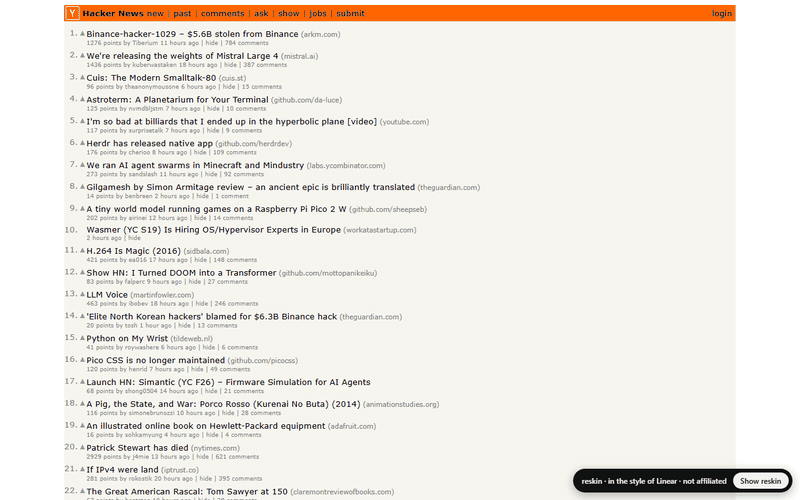
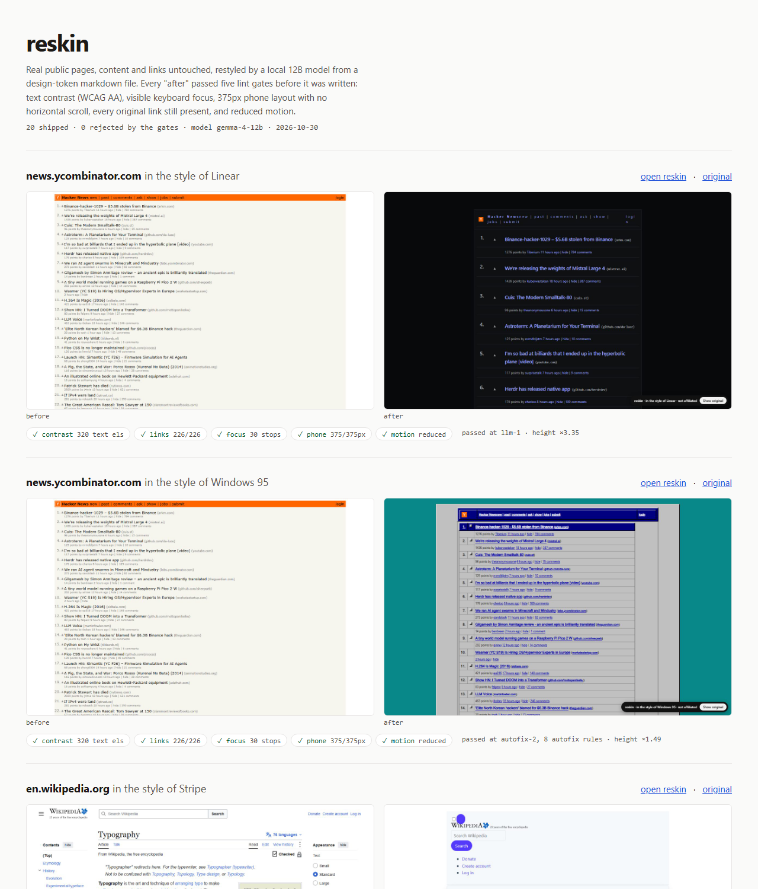

# reskin

Restyle any public web page "in the style of" a design system, using a local LLM, and refuse to
ship the result unless it passes accessibility and integrity gates.

```
reskin https://news.ycombinator.com --style linear
```



- **Content and links untouched.** The page is fetched logged out with Playwright, frozen to a
  script-free snapshot, and only CSS (plus the site's own icon sprites) changes. The original
  stylesheets are kept, parked, so the in-page pill (or Alt+Shift+R) flips back to the original.
- **Design system as markdown.** `styles/*.md` hold tokens (colors, type, spacing, radius, shadow,
  motion) in frontmatter plus a short prose "voice". The LLM only writes CSS that refers to those
  tokens; a sanitizer drops anything else.
- **Gates before output.** Nothing is written to `index.html` unless all five pass:

| gate     | what it checks |
|----------|----------------|
| contrast | every visible text element meets WCAG AA (4.5:1, 3:1 for large text) against its real composited background |
| focus    | Tab through up to 30 stops; each must show a ≥2px outline at ≥3:1 or a changed ring |
| phone    | at 375px, no horizontal page scroll (wide tables may scroll inside their own box) |
| links    | every original link (href + text) is still present and still visible |
| motion   | with `prefers-reduced-motion: reduce`, nothing animates or transitions |

If gates fail, the model gets the failures back for one more attempt, then up to two deterministic
autofix rounds run. Still failing: `rejected.html` for debugging, exit code 2, nothing shipped.

## Gallery

`gallery/index.html` holds the before/after pairs with each pair's gate results.



Run 2026-10-30 against gemma-4-12b: **20/20 shipped**. 14 passed on the first model attempt, 2 after one
round of gate feedback, 4 needed deterministic autofix (1-8 rules). Getting there took real fixes, all
caught by the gates: lost icon links on HN, a win95 token that failed AA on its own canvas, a focus
ring that vanished on navy rows, and Wikipedia backlinks drawn only by CSS.

| site | style | passed at | autofix rules | links | text els checked | tab stops | height vs original |
|---|---|---|---|---|---|---|---|
| berkshirehathaway.com | linear | llm-1 | 0 | 18 | 34 | 19 | x1.47 |
| berkshirehathaway.com | win95 | autofix-1 | 1 | 18 | 34 | 19 | x1.28 |
| en.wikipedia.org | stripe | llm-1 | 0 | 1251 | 1144 | 30 | x1.39 |
| en.wikipedia.org | teenage-engineering | llm-2 | 0 | 1251 | 1144 | 30 | x1.09 |
| gov.uk | apple | llm-1 | 0 | 86 | 93 | 30 | x1.39 |
| gov.uk | linear | llm-1 | 0 | 86 | 93 | 30 | x1.09 |
| info.cern.ch | linear | llm-1 | 0 | 25 | 40 | 26 | x1.23 |
| info.cern.ch | stripe | llm-1 | 0 | 25 | 40 | 26 | x1.42 |
| lite.cnn.com | apple | llm-1 | 0 | 111 | 126 | 30 | x2.73 |
| lite.cnn.com | teenage-engineering | llm-2 | 0 | 111 | 126 | 30 | x1.77 |
| news.ycombinator.com | linear | llm-1 | 0 | 226 | 320 | 30 | x3.35 |
| news.ycombinator.com | win95 | autofix-2 | 8 | 226 | 320 | 30 | x1.49 |
| sfbay.craigslist.org | apple | llm-1 | 0 | 269 | 304 | 30 | x5.49 |
| sfbay.craigslist.org | vercel | autofix-1 | 3 | 269 | 304 | 30 | x9 |
| text.npr.org | stripe | llm-1 | 0 | 28 | 35 | 29 | x1.91 |
| text.npr.org | vercel | llm-1 | 0 | 28 | 35 | 29 | x1.5 |
| usa.gov | vercel | llm-1 | 0 | 77 | 98 | 30 | x1.51 |
| usa.gov | win95 | autofix-1 | 2 | 77 | 98 | 30 | x1.05 |
| w3.org | stripe | llm-1 | 0 | 7 | 119 | 8 | x1.49 |
| w3.org | teenage-engineering | llm-1 | 0 | 7 | 119 | 8 | x1.15 |

Height grows on most pages (document sites get roomier). Craigslist grows 5-9x: its multi-column
landing page unrolls into one column.

Known rough edges: inline link lists can lose their separators (craigslist footer); some icon-only
toggles that are not `<button>`s still pick up accent styling (Wikipedia); spacing judgement is
the model's and varies run to run.

## Use

Requires Node 20+, `npx playwright install chromium`, and an OpenAI-compatible llama-server on
`localhost:8080` (tested with gemma-4-12b, thinking disabled).

```
npm install
LLAMA_API_KEY=... node bin/reskin.mjs <url> --style <style> [--out dir] [--refetch]
node scripts/gallery.mjs          # all pairs, sequentially
node scripts/build-gallery.mjs    # gallery/index.html
npm test                          # gate tests
```

If `LLAMA_API_KEY` is unset, the key is read from the running llama-server's command line at
runtime. It is never written to disk. LLM responses are cached by prompt hash in `.llm-cache/`.

Styles: `apple`, `linear`, `stripe`, `teenage-engineering`, `vercel`, `win95`. Add your own by
copying one; every color token in `colors:` is required.

## Output

```
out/<site>--<style>/
  index.html     reskinned page with toggle (only if every gate passed)
  before.jpg     the live page    after.jpg   the reskin    phone.jpg   375px
  llm-N.css      sanitized model output per attempt
  autofix.css    deterministic fixes, if any
  report.json    gate results, attempts, timing
```

## Not affiliated

"In the style of X" is a reading of a public design language. No logos or brand assets are used,
and nothing here is affiliated with or endorsed by any company named or any site shown.

## Credits

- Design-language reference text: [VoltAgent/awesome-design-md](https://github.com/VoltAgent/awesome-design-md)
  (read as reference only; the tokens in `styles/` are my own).
- Motion values: awesome-motion-md.
- The gate set follows hallmark's accessibility floor (contrast, focus, reduced motion, phone layout).

MIT

## License

- **Code:** [Apache-2.0](LICENSE).
- **Gallery:** the restyled pages are third-party content shown to demonstrate the tool. See [NOTICE-GALLERY.md](NOTICE-GALLERY.md).
